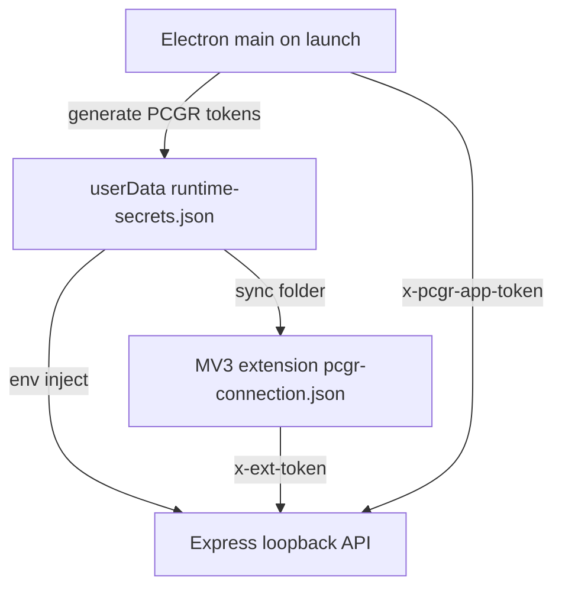
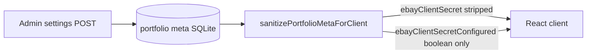
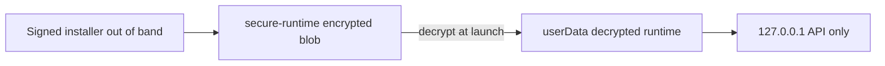
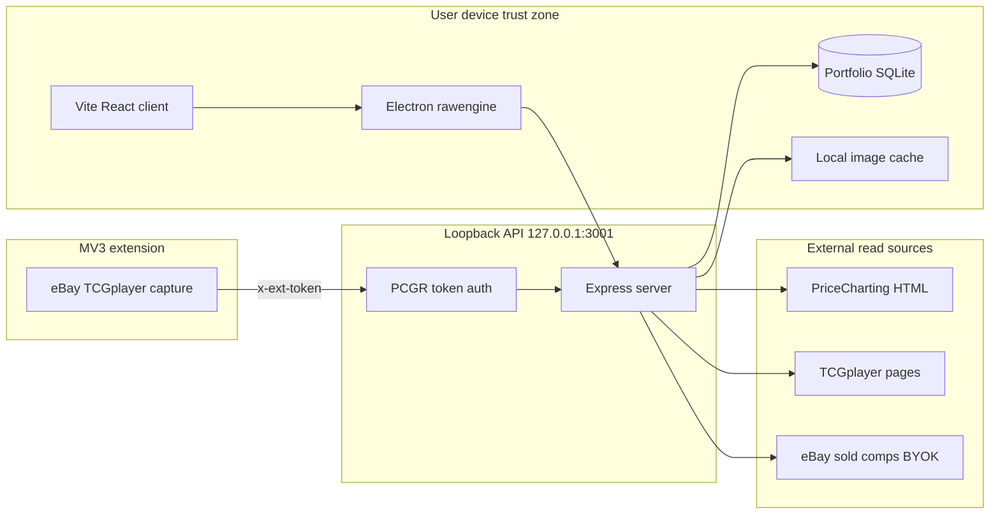
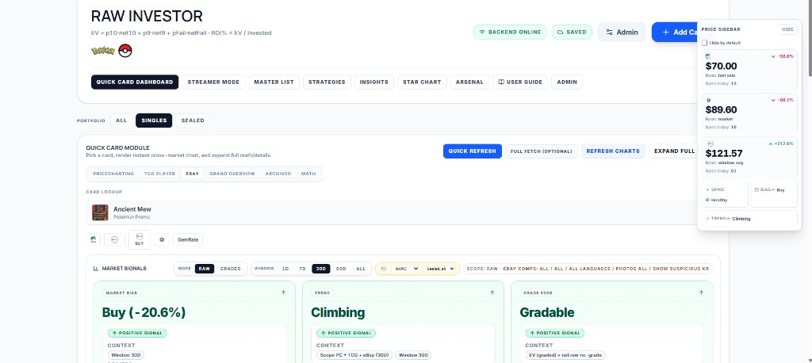
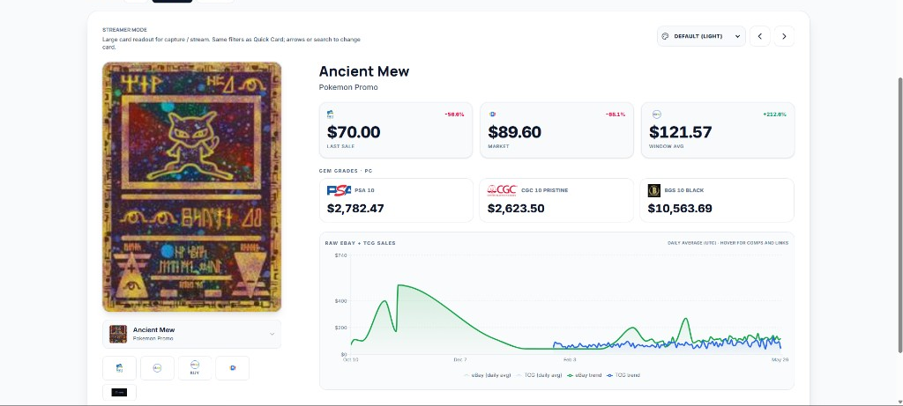
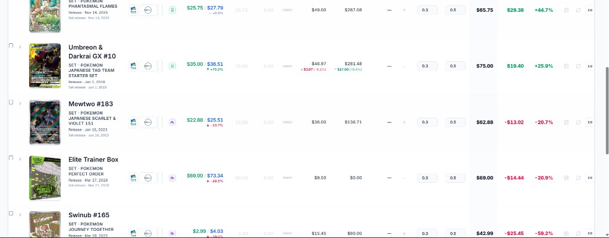
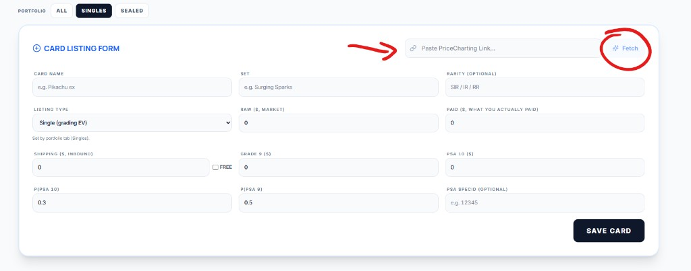
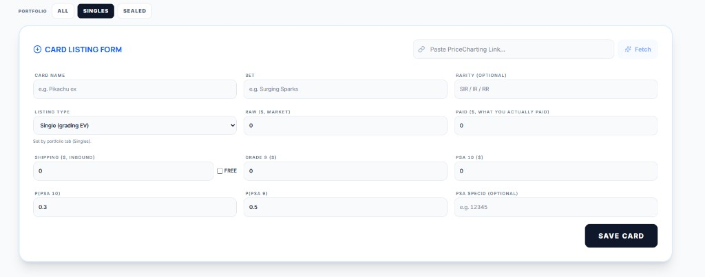
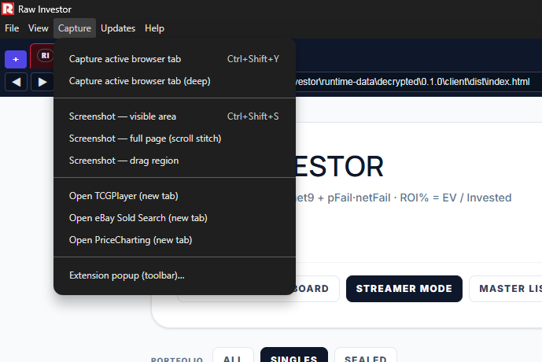

<div align="center">

# RawInvestor

**Local-first TCG investing workstation — Market Bias, grading EV, and ROI forecasts from blended marketplace data.**

[](LICENSE)
[](https://apps.microsoft.com/detail/9PGX48NMDWQT)
[](https://github.com/RawPowered)

[rawgraded.com/download/investor/](https://rawgraded.com/download/investor/) · **Public assurance repository** — architecture reference for security and engineering review

</div>

<p align="center">
  <a href="https://apps.microsoft.com/detail/9PGX48NMDWQT">
    
  </a>
</p>

---

## Why this exists

Deciding what to do with a raw Pokémon TCG card means juggling PriceCharting, TCGplayer, and eBay sold listings by hand — with no unified view, no grading expected-value math, and pricing distorted by scalper noise.

RawInvestor blends those sources into **per-card decision signals** on your own machine: Market Bias, Trend, Sales Strategy, Grading EV, and 90-day ROI forecasts.

This repository is a **deliberately scoped public source publication**: application logic, loopback API control patterns, extension capture boundaries, and client security behavior suitable for third-party review. **Production artifacts** (signed installers, encrypted runtime blobs, MSIX store identity, and operator signing credentials) ship through the [Microsoft Store](https://apps.microsoft.com/detail/9PGX48NMDWQT) and [rawgraded.com/download/investor/](https://rawgraded.com/download/investor/) — not as secrets embedded in this tree.

**Created by:** [Joseph Edwards (@RawPowered)](https://github.com/RawPowered) · MIT licensed

---

## For three types of readers

| Reader | What this means for you | Start here |
|---|---|---|
| **Collectors / traders** | Multi-source signals, grading EV, portfolio ROI — local-first, no vendor cloud account | [Product capabilities](#product-capabilities) · [How the software works](#how-the-software-works) · [Platform showcase](#platform-showcase) |
| **Partners / marketplace reviewers** | Data read from user-initiated browser/extension sessions; no RawGraded cloud portfolio upload | [PII controls](#pii-credentials-and-data-leak-controls) · [Legal disclaimers](#legal-data-and-investment-disclaimers) |
| **Engineers / security reviewers** | Loopback token auth, secret sanitization on meta API, publication boundary | [Security posture](#security-posture-at-a-glance) · [Security architecture (visual)](#security-architecture-visual-layouts) · [Threat model](#threat-model-and-trust-boundaries) · [Release integrity](#release-integrity) |

> Pick your lane above; everything below is organized for depth, not linear reading.

---

## Security posture at a glance

| Principle | Implementation |
|---|---|
| **Local-first default** | Portfolio SQLite, cached card images, and extension capture history stay on-device |
| **Loopback API** | Express serves `127.0.0.1:3001` by default — not exposed as a public cloud service |
| **Production token auth** | `PCGR_APP_TOKEN`, `PCGR_EXT_TOKEN`, `PCGR_MAINT_TOKEN` required when `NODE_ENV=production` |
| **Secrets out of source** | eBay OAuth keys via env or Admin settings; **never returned** to the client on meta read |
| **Extension boundary** | MV3 capture POSTs to loopback with `x-ext-token`; CORS allows extension origins only |
| **Publication boundary** | No encrypted runtime keys, signing certs, user DB dumps, or production build output in this repo |
| **Release integrity** | [`scripts/publish-preflight.cjs`](scripts/publish-preflight.cjs) enforces artifact policy before any public push |

---

<a id="security-architecture-visual-layouts"></a>

## Security architecture (visual layouts)

Diagrams for reviewers who want the control flow before reading source. **BACKEND ONLINE** and **SAVED** in the UI mean the **local loopback API** and **local SQLite** are reachable — not a vendor cloud sync.

### Auth token lifecycle



Implemented in [`rawengine/main.cjs`](rawengine/main.cjs) (runtime-secrets generation) and [`server/src/index.ts`](server/src/index.ts) (`requireExtToken`, `requireStoreWriteAuth`, `strictAuthMode`).

### eBay secret sanitization



Server-side strip before any meta JSON reaches the renderer — see `sanitizePortfolioMetaForClient()` in [`server/src/index.ts`](server/src/index.ts).

### Packaged runtime boundary



Encrypted runtime blobs and signing material are **not** in this assurance tree; reviewers evaluate the loopback + token patterns in source.

| Layer | What reviewers verify | Source |
|---|---|---|
| **Loopback bind** | API defaults to `127.0.0.1:3001` | [`extension/pcgr-connection.json`](extension/pcgr-connection.json), Electron spawn |
| **Token gate** | Production mutating routes need `PCGR_*` headers | [`server/src/index.ts`](server/src/index.ts) |
| **Secret strip** | eBay client secret never returned to UI | `sanitizePortfolioMetaForClient()` |
| **Publication** | No `.env`, DB dumps, or live tokens in git | [`scripts/publish-preflight.cjs`](scripts/publish-preflight.cjs) |

---

## Threat model and trust boundaries

### Data flow at a glance



### Assumptions

- Attackers may read this repository, fuzz `/api/*`, and attempt extension token replay on a LAN.
- In **production hardened mode**, mutating API routes require valid loopback tokens injected by Electron or the synced extension config.
- Users control their own marketplace browser sessions; RawInvestor does not store eBay/TCGplayer passwords in source.

### Out of scope

- Marketplace account takeover on third-party sites (user browser responsibility).
- Investment outcome guarantees — signals are estimates from public and user-captured listing data.

---

## PII, credentials, and data-leak controls

| Data class | Storage | Client exposure |
|---|---|---|
| Portfolio cost basis, notes, card payloads | Local SQLite (`PCGR_DATA_DIR`) | Same machine only |
| eBay OAuth app secret | Env or portfolio meta on server | **Stripped** — `sanitizePortfolioMetaForClient()` removes `ebayClientSecret`; exposes boolean `ebayClientSecretConfigured` only ([`server/src/index.ts`](server/src/index.ts)) |
| Extension capture payloads | Local SQLite + optional history tables | Loopback API; no cloud upload path in source |
| Cached card images | `PCGR_IMAGES_DIR` filesystem | Served via `/images` static route on loopback |
| PSA API token | User-supplied `x-psa-token` header | Optional; never embedded in repository |
| Runtime auth tokens | `%APPDATA%`-style userData `runtime-secrets.json` | Generated at first Electron launch; not committed |

Extension connection defaults ship with **empty tokens** in [`extension/pcgr-connection.json`](extension/pcgr-connection.json); the desktop app writes tokens when syncing the extension folder.

---

## How the software works

### Pipeline

1. **Ingest** — Paste a PriceCharting URL for header-aware HTML scrape (column mapping by `<th>` text, not brittle IDs) + optional MV3 capture from TCGplayer/eBay tabs the user already has open.
2. **Normalize** — Merge extension payloads into portfolio SQLite ([`mergeExtensionCaptureIntoPortfolio`](server/src/portfolioExtensionMerge.ts)).
3. **Analyze** — Deterministic grading EV math, trend/regression across **1 / 7 / 30 / 90-day** windows, Market Bias / Sales Strategy / Nebula portfolio classification.
4. **Decide** — 90-day ROI forecast with trend clamping; streamer-mode share graphics exported locally.

### Grading EV math (deterministic)

For each card:

```
totalInvested = raw + gradingFee + shipToGrader + shipFromGrader
netForSalePrice(sp) = sp * (1 - saleFeePct) - saleFeeFlat - shipToBuyer - totalInvested
EV = p10 * net10 + p9 * net9 + pFail * netFail
ROI % = EV / totalInvested * 100
```

Grade probabilities (`p10`, `p9`) are **per-card and user-tunable** — defaults are starting points, not predictions of PSA outcomes.

**Proof in source:** Vitest suites under [`server/`](server/) (scraper/parser) and [`client/`](client/) (EV math).

---

## Product capabilities

Shipped features (Microsoft Store listing and direct downloads):

- **Multi-source blend** — PriceCharting scrape + TCGplayer capture + optional eBay sold comps (BYOK application OAuth)
- **Market Bias** — synthesized Buy / Hold / Sell guidance from buyer-side and seller-side analytics
- **Trend** — regression slope, z-score vs. historical mean, day-over-day moves across configurable windows
- **Sales Strategy** — SELL/HOLD with fair, strategic, and pushed price targets per channel
- **Grading EV** — expected value across PSA 10 / 9 / fail branches vs. raw-flip break-even
- **90-day ROI forecast** — realistic / best / worst cases with trend clamping on thin data
- **Nebula 3D portfolio classification** — Buy / Sell / Hold / Sleeper / Climber / Dud / NGMI buckets
- **Arsenal deal targets**, sealed product EV, themed share graphics, streamer mode
- **Uses AI features** (Microsoft Store badge) — local analytics and signal synthesis over marketplace data captured in the user's own browser/extension context; **not** a cloud portfolio upload product

---

## Platform showcase

| Store | Quick Card signals | Streamer Mode | Master List |
|:---:|:---:|:---:|:---:|
| <a href="#platform-showcase"></a> | <a href="#platform-showcase"></a> | <a href="#platform-showcase"></a> | <a href="#platform-showcase"></a> |

*Click a bar to expand.*

<details open>
<summary><picture></picture></summary>

<br>

<a href="https://apps.microsoft.com/detail/9PGX48NMDWQT"></a>

First RAW ENGINE Microsoft Store listing · **Uses AI features** badge · install via [Store](https://apps.microsoft.com/detail/9PGX48NMDWQT) or [direct download](https://rawgraded.com/download/investor/)

</details>

<details>
<summary><picture></picture></summary>

<br>

| Fetch & research | Card-level EV |
|:---:|:---:|
|  |  |

</details>

<details>
<summary><picture></picture></summary>

<br>



MV3 extension captures TCGplayer/eBay context from the user's own logged-in sessions and POSTs to loopback only.

</details>

<details>
<summary><picture></picture></summary>

<br>


Per-card decision surface: **Market Bias**, **Trend**, and **Grade Edge** cards with configurable RAW/GRADED windows (1D–90D), plus a floating Price Sidebar fed from eBay/TCGplayer/PriceCharting blends. Ties to [Product capabilities](#product-capabilities).

</details>

<details>
<summary><picture></picture></summary>

<br>


Large-format card readout for stream capture: last sale, market, window average, gem-grade price tiers, and RAW eBay + TCG sales history — exported locally, no cloud upload path.

</details>

<details>
<summary><picture></picture></summary>

<br>


Portfolio-scale view: sort and filter singles/sealed across sets with per-row EV, net profit, and ROI% — powered by the same deterministic math in [How the software works](#how-the-software-works).

</details>

---

## Release integrity

Before any public push:

```bash
node scripts/publish-preflight.cjs
```

The gate fails on `.env` files, SQLite dumps, PEM/PFX material, live OAuth secrets, non-empty extension tokens, and common credential patterns in tracked text.

Operator export from the private monorepo uses `scripts/publish-assurance-export.mjs` (not published here) to produce this scrubbed tree.

---

## Legal, data, and investment disclaimers

- **Not financial advice.** RawInvestor produces research estimates from public listing data and user-captured marketplace context. It is not a registered investment adviser and does not recommend specific securities or transactions.
- **No outcome guarantees.** Grading probabilities are user-adjustable inputs. Market data can be stale, incomplete, or distorted by scalper activity. ROI forecasts clamp extremes but cannot predict future prices.
- **Third-party marks.** Pokémon, PSA, BGS, CGC, eBay, TCGplayer, PriceCharting, Microsoft, and related names/logos are used descriptively only. **No endorsement, partnership, employment, or agency relationship is implied.**
- **Marketplace compliance.** Users are responsible for third-party site terms of service. The capture extension reads pages in browsers the user controls; RawInvestor does not bypass paywalls or authentication systems in source.
- **Assurance repository scope.** This tree is a source reference for review. Production encryption, code signing, MSIX packaging, and encrypted runtime distribution remain operator-controlled and out of band.

---

## Development (reviewers)

```bash
npm run install:all
npm run dev          # API :3001 + Vite :5173
npm test             # server + client Vitest
```

See [`.env.example`](.env.example) for optional eBay and token variables. Packaged Electron builds require additional operator tooling not included in this assurance publication.

**More:** [RAW ENGINE profile](https://github.com/RawPowered) · [RawGraded assurance repo](https://github.com/RawPowered/RawGraded)
