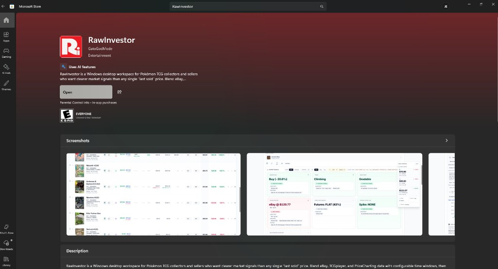

# RawInvestor

**A local-first TCG investing workstation: buy, hold, grade, or sell — with math, not vibes.**

  

<em>Published on Microsoft Store — blends eBay, TCGplayer, and PriceCharting with configurable windows and local-first architecture.</em>

**RAW ENGINE's first official Microsoft Store listing** — install RawInvestor from the [Microsoft Store](https://apps.microsoft.com/detail/9PGX48NMDWQT) or use direct downloads from [rawgraded.com](https://rawgraded.com/download/investor/).

One workspace blends PriceCharting, TCGplayer, and eBay sold data into per-card decision signals:

- **Market Bias** — synthesized Buy / Hold / Sell guidance
- **Trend** — regression slope, z-scores, day-over-day moves across 1 / 7 / 30 / 90-day windows
- **Sales Strategy** — SELL/HOLD signals with fair, strategic, and pushed price targets
- **Grading EV** — expected value across PSA 10 / 9 / fail branches vs. raw-flip break-even
- **90-day ROI forecast** — realistic / best / worst cases with trend clamping

**Architecture:** desktop app with embedded browser workspace, a loopback-only local API, and a local database as the authoritative portfolio store. No vendor cloud sync, no account, no tracking.

**Also available direct:** portable .zip and NSIS installer from [rawgraded.com/download/investor/](https://rawgraded.com/download/investor/) — extension setup and user guide linked there.

**Highlights:** Nebula 3D portfolio classification, deal-hunting Arsenal targets, sealed product EV, themed share graphics, streamer mode.

> This repo is a public landing page. The product is closed-source; part of the [RAW ENGINE](https://github.com/GatoGodMode/RawEngine) suite.

**More:** [How the engine works](https://github.com/GatoGodMode/RawEngine) · [Full architecture breakdown on my profile](https://github.com/GatoGodMode)
